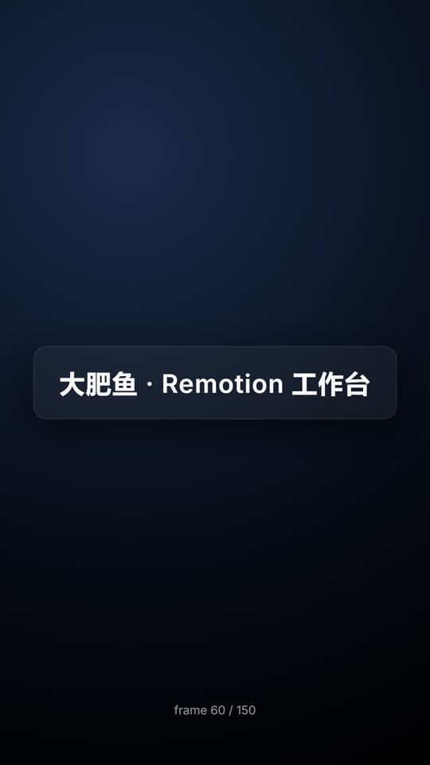

# 大肥鱼 · Remotion 工作台

一个开箱能跑的 [Remotion](https://www.remotion.dev/) 工程：用 React 写视频，重点是**双采质感**（`@remotion/motion-blur` 动态模糊）和**冲击帧**（白闪 / Hit Stop / 变速曲线）——AI 视频流水线里「质感层」的执行端。



> 1080×1920 / 30fps 样板，`spring` 入场 + `CameraMotionBlur` 6 采样。

## 为什么是 Remotion

- **逐帧确定性**：每帧都是 React 组件，时间精确到帧，重音对齐不靠人眼拖。
- **代码即特效**：动态模糊、白闪、冻结、变速都是代码，改一行就能换一版，不用打开剪辑软件。
- **零素材成本**：画面由代码画出来，不依赖生图 API。

配合 `dsh-remotion`（Remotion 官方 12 技能）使用，agent 可以直接写 composition。

## 快速开始

```bash
git clone https://github.com/duplicatename10086/dsh-Remotion.git
cd dsh-Remotion
npm install
npx remotion studio        # 可视化预览，改代码即时热更新
```

渲染：

```bash
npx remotion render HelloMotion out/hello.mp4
npx remotion still  HelloMotion out/hello.png --frame=60
```

首次 `render` 会自动下载 Chrome Headless Shell（约 150 MB）。

## 目录结构

```
├─ src/
│  ├─ index.ts          # 注册入口
│  ├─ Root.tsx          # composition 清单：id / 尺寸 / 时长 / fps
│  └─ Hello.tsx         # 样板：spring 入场 + motion-blur 双采质感
├─ remotion.config.ts   # 输出格式（默认 jpeg 帧、覆盖同名输出）
├─ docs/
│  ├─ preview.jpg       # 预览帧
│  └─ pipeline.md       # 这套工程在 AI 视频流水线里的定位
└─ package.json
```

## 常用脚本

| 命令 | 作用 |
|---|---|
| `npm run studio` | 打开 Remotion Studio（时间轴 + 热更新） |
| `npm run render` | 渲染成片，需带 composition 名与输出路径 |
| `npm run out` | 一键渲染样板 → `E:\成品视频\成片\hello.mp4` |
| `npm run out:still` | 渲染第 60 帧 → `E:\成品视频\素材\图片\hello.png` |
| `npm run still` | 渲染任意单帧 |

> `out` / `out:still` 是本机流水线约定（产物统一落 `E:\成品视频`），换机器请改 `package.json` 里的路径。

## 自己加一个视频

1. 新建 `src/MyVideo.tsx`，写一个普通 React 组件，用 `useCurrentFrame()` / `interpolate()` 拿时间。
2. 在 `src/Root.tsx` 里加 `<Composition id="MyVideo" component={MyVideo} durationInFrames={...} fps={30} width={1080} height={1920} />`。
3. `npx remotion render MyVideo out/my.mp4`。

需要动态模糊就把运动层包起来：

```tsx
import { CameraMotionBlur } from "@remotion/motion-blur";

<CameraMotionBlur samples={6} shutterAngle={180}>
  {/* 会动的内容 */}
</CameraMotionBlur>
```

## 要求

- Node.js 22+
- Remotion 4.0.542（工程内锁定）
- Windows / macOS / Linux 均可

## 相关

- [Remotion 文档](https://www.remotion.dev/docs)
- [@remotion/motion-blur](https://www.remotion.dev/docs/motion-blur)
- 流水线定位见 [docs/pipeline.md](docs/pipeline.md)

## License

[MIT](LICENSE)
